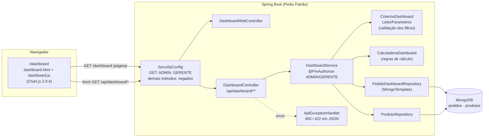
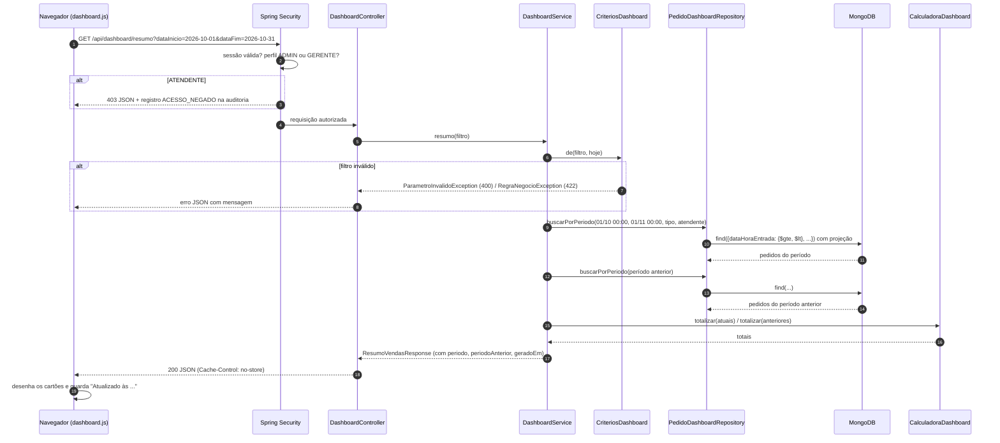
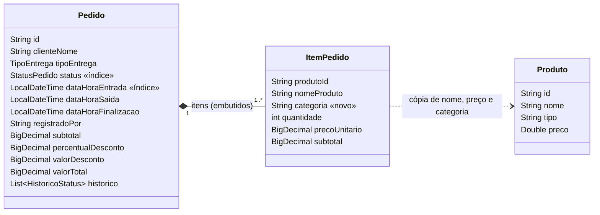

# 2. Análise e projeto

[← Requisitos](01-requisitos.md) · [Índice](README.md) · [Endpoints →](03-api-endpoints.md)

## 2.1 Visão geral da arquitetura

O dashboard segue a mesma arquitetura em camadas do projeto: tela → controlador → serviço → repositório → MongoDB. A novidade é uma camada de **cálculo pura** (`CalculadoraDashboard`), separada do serviço para poder ser testada sem Spring e sem banco.



| Camada | Classe | Responsabilidade |
|---|---|---|
| Tela | `templates/dashboard.html`, `static/js/dashboard.js`, `static/css/dashboard.css` | Estrutura da página, filtros, gráficos, tabelas, atualização automática e tratamento de erros no navegador |
| Controlador | `DashboardWebController` | Entrega a página dentro do layout do sistema |
| Controlador | `DashboardController` | Traduz HTTP ↔ serviço (8 endpoints `GET`) |
| Serviço | `DashboardService` | Valida os filtros, busca os dados, aciona os cálculos e monta as respostas. Autorização por método |
| Validação | `CriteriosDashboard`, `LeitorParametros` | Período padrão, limites, conversão de texto em opções, mensagens de erro |
| Cálculo | `CalculadoraDashboard` | Totais, comparação, séries, distribuições, ranking, situação, fila, rateio de desconto, máscara de nome |
| Dados | `PedidoDashboardRepository` | Consultas ao MongoDB com filtro, projeção, ordenação e paginação |
| DTOs | `dto/dashboard/*` (records) | Contratos JSON da API |
| Demonstração | `DemonstracaoDashboardConfig`, `GeradorPedidosDemonstracao` | Perfil `demo`: histórico de pedidos de exemplo em banco separado |

## 2.2 Fluxo de uma consulta



A tela dispara as consultas dos 7 painéis em paralelo. Cada painel tem seu próprio `AbortController`: se o usuário muda um filtro antes da resposta chegar, a requisição antiga é cancelada.

## 2.3 Modelagem de dados

O dashboard **não cria coleções novas**: ele lê os documentos de `pedidos` (e `produtos`, para categorias de itens antigos). A modelagem existente já tinha quase tudo o que os indicadores precisam. Foram feitas duas alterações:

1. **`ItemPedido.categoria`** (novo campo): a categoria do produto (Pizza, Esfiha, Bebida…) é copiada para o item no momento do pedido, como já acontecia com nome e preço. Assim o histórico não muda se o produto for recategorizado ou excluído depois.
2. **Índices** em `Pedido.dataHoraEntrada` (descendente) e `Pedido.status`, criados automaticamente (`spring.data.mongodb.auto-index-creation=true`). Eles atendem as consultas por período e a fila de pedidos em aberto.



**Exemplo de documento** (campos usados pelo dashboard; a projeção da consulta traz só estes):

```json
{
  "_id": "6650a1b2c3d4e5f6a7e4fb29",
  "clienteNome": "Ana Paula Ribeiro",
  "tipoEntrega": "ENTREGA",
  "itens": [
    { "produtoId": "...", "nomeProduto": "Pizza Calabresa", "categoria": "Pizza",
      "quantidade": 2, "precoUnitario": 54.90, "subtotal": 109.80 }
  ],
  "subtotal": 109.80, "percentualDesconto": 10.00, "valorDesconto": 10.98, "valorTotal": 98.82,
  "status": "FINALIZADO",
  "dataHoraEntrada": "2026-10-31T22:56:00",
  "dataHoraSaida": "2026-10-31T23:45:00",
  "dataHoraFinalizacao": "2026-11-01T00:10:00",
  "registradoPor": "atendente01"
}
```

**Consultas geradas** (verificadas em `PedidoDashboardRepositoryTest`):

| Uso | Filtro no MongoDB | Ordenação / página |
|---|---|---|
| Indicadores, séries, distribuições, ranking, situação | `{dataHoraEntrada: {$gte: início, $lt: fim+1 dia}, tipoEntrega?, registradoPor?}` | — |
| Pedidos em aberto (tempo real) | `{status: {$in: [RECEBIDO, EM_PREPARACAO, PRONTO, SAIU_PARA_ENTREGA, RETIRADO]}, tipoEntrega?}` | — |
| Lista paginada | filtro do período + `status?` | `dataHoraEntrada` desc, `skip`/`limit` + `count` |
| Opções de atendente | `distinct("registradoPor")` | — |

## 2.4 Projeto da API

Princípios adotados:

- **Recursos orientados às perguntas do gestor:** `resumo`, `vendas/serie`, `vendas/distribuicao`, `produtos/mais-vendidos`, `pedidos/situacao`, `pedidos/em-aberto`, `pedidos` e `filtros`. Cada painel da tela usa um endpoint, que pode ser atualizado sozinho.
- **Somente `GET`** e parâmetros na query string. As consultas são idempotentes e o link pode ser compartilhado.
- **Filtros comuns iguais em todos os endpoints** (`dataInicio`, `dataFim`, `tipoEntrega`, `atendente`), mais parâmetros específicos opcionais com valores padrão.
- **Resposta autoexplicativa:** cada resposta devolve o `periodo` efetivamente usado (útil quando o cliente omite as datas) e `geradoEm`.
- **Erros padronizados** no mesmo formato `ErroResposta` já usado pelo sistema. **400** indica parâmetro mal formado; **422** indica parâmetros válidos que violam regra de negócio.
- **Valores aceitos descobríveis** via `GET /api/dashboard/filtros`, o que evita deixar listas fixas no front-end.

## 2.5 Principais decisões de projeto

| Decisão | Alternativas consideradas | Justificativa |
|---|---|---|
| **Filtrar no MongoDB e agregar em Java** (`CalculadoraDashboard`) | Pipeline de agregação do MongoDB (`$group`, `$dateToString`) | (1) O Spring Data converte `LocalDateTime` usando o fuso da JVM, e agrupar por hora/dia no Mongo exigiria repetir a regra de fuso no pipeline; em Java a hora é exatamente a que o sistema exibe. (2) As regras (rateio de desconto, dados legados, variação com divisor zero) ficam em um só lugar e são testadas sem banco. (3) O volume de uma pizzaria (centenas de pedidos por dia) é pequeno, e os índices, a projeção e o limite de 366 dias mantêm o custo baixo. Evolução possível: coleção de totais diários ou pipeline, se o volume crescer muito |
| **Índices** em `dataHoraEntrada` e `status` | Sem índice | As duas consultas mais frequentes (período e fila) filtram por esses campos |
| **Categoria copiada para o item** | Buscar sempre no cadastro de produtos | Preserva o histórico, como já era feito com nome e preço. Itens antigos usam o cadastro atual como alternativa |
| **Desconto rateado entre os itens** | Ranking com valor bruto | O faturamento por produto/categoria fecha com o faturamento do resumo, sem dois "faturamentos" diferentes no mesmo painel |
| **Venda = pedido não cancelado** | Somar só os finalizados | Pedido registrado e não cancelado é venda realizada (o cancelamento só ocorre antes da saída). Pedidos em andamento aparecem num indicador próprio |
| **Comparação com o período anterior** | Mostrar só o valor absoluto | Dá contexto à tomada de decisão ("vendi mais ou menos que antes?"). A variação é `null` quando não há base, para não exibir porcentagens infinitas |
| **ADMIN e GERENTE**; ATENDENTE bloqueado | Liberar a todos | São dados gerenciais. O ADMIN vê nomes mascarados, coerente com a minimização já aplicada na auditoria |
| **Duas camadas de autorização** (rota + `@PreAuthorize`) | Só a rota | Mesmo padrão do projeto. Um controlador futuro que chame o serviço continua protegido |
| **400 × 422** | Tudo 400 | Distingue "parâmetro mal escrito" de "pedido logicamente inválido", o que ajuda o cliente da API a corrigir |
| **Thymeleaf + JS puro + Chart.js 2.9.4 local** | SPA (React/Vue), Chart.js 4 via CDN | Mantém a stack e o visual do sistema, sem build de front-end. O Chart.js já estava no projeto e funciona sem internet |
| **Um gráfico, uma série, um eixo** | Gráficos com dois eixos (faturamento × pedidos) | Dois eixos induzem correlações falsas. A troca de medida (faturamento / pedidos / ticket) é feita por botões |
| **Atualização automática por *polling*** (30 s a 5 min) | WebSocket / Server-Sent Events | É simples e suficiente para indicadores gerenciais. Pausa com a aba oculta para não gastar recursos |
| **Perfil `demo` com banco separado** | Gerar dados no banco principal | Permite apresentar com histórico realista sem misturar pedidos fictícios aos reais |

## 2.6 Organização dos arquivos

```
src/main/java/com/umc/pediupatrao/
├── controller/
│   ├── DashboardController.java          (API /api/dashboard/**)
│   └── DashboardWebController.java       (tela /dashboard)
├── dto/dashboard/                        (records de resposta, filtro e enums de opções)
├── repository/PedidoDashboardRepository.java
├── service/
│   ├── DashboardService.java
│   └── dashboard/
│       ├── CalculadoraDashboard.java
│       ├── CriteriosDashboard.java
│       └── LeitorParametros.java
├── exception/ParametroInvalidoException.java
└── config/
    ├── DemonstracaoDashboardConfig.java  (perfil demo)
    └── GeradorPedidosDemonstracao.java
src/main/resources/
├── templates/dashboard.html
├── static/js/dashboard.js
├── static/css/dashboard.css
└── application-demo.properties
```
