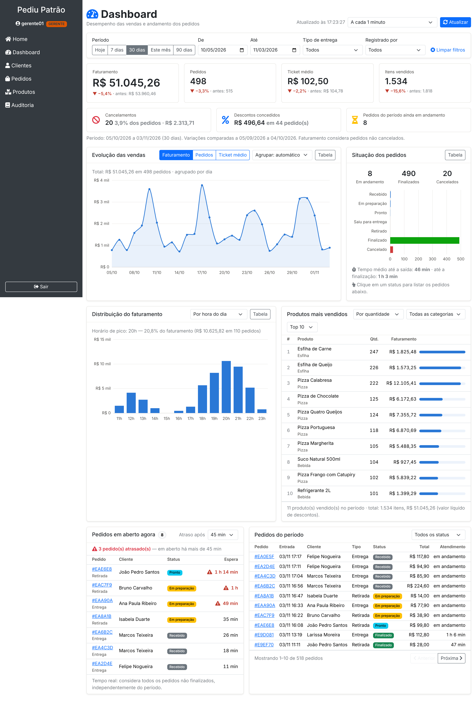

# 4. Evidências de testes

[← Endpoints](03-api-endpoints.md) · [Índice](README.md) · [Implementação e gitflow →](05-implementacao-e-gitflow.md)

Foram realizados quatro tipos de teste, do mais isolado ao mais completo:

| Nível | Ferramenta | O que cobre | Resultado |
|---|---|---|---|
| Unitário e integração (automatizados) | JUnit 5, Mockito, AssertJ, MockMvc | Regras de cálculo, validação de filtros, consultas ao MongoDB, segurança da API e contrato JSON | **139 testes, 0 falhas** (71 novos + 68 que já existiam) |
| API via HTTP | `curl` ([`testes-api.sh`](testes-api.sh)) | 28 cenários contra a aplicação rodando: perfis, endpoints e erros | **28 aprovados, 0 reprovados** |
| API via Postman | [`PediuPatrao-Dashboard.postman_collection.json`](PediuPatrao-Dashboard.postman_collection.json) | 25 requisições com 56 verificações automáticas de status e conteúdo | **56 verificações aprovadas** |
| Interface (E2E) | Playwright (Chromium), desktop e celular | Login, carga do dashboard, filtros, gráficos, interações, erros, perfis | Capturas abaixo, sem erros de JavaScript |

## 4.1 Testes automatizados (JUnit)

Os testes **não precisam de MongoDB nem de internet**. Para rodar:

```bash
./mvnw test        # Windows: mvnw.cmd test
```

Execução de referência: 03/11/2026, Java 21, Spring Boot 3.4.4. Relatórios do Surefire em [`evidencias/relatorio-testes/`](evidencias/relatorio-testes/).

| Classe de teste | Situação | Testes | Aprovados | Falhas |
|---|---|---:|---:|---:|
| `config.AutorizacaoServicosTest` | existente | 6 | 6 | 0 |
| `config.DashboardApiTest` | **nova** | 11 | 11 | 0 |
| `config.DashboardAutorizacaoTest` | **nova** | 2 | 2 | 0 |
| `config.GeradorPedidosDemonstracaoTest` | **nova** | 5 | 5 | 0 |
| `config.SegurancaApiTest` | existente | 15 | 15 | 0 |
| `entity.CampoAlteradoTest` | existente | 2 | 2 | 0 |
| `entity.PedidoTest` | existente | 3 | 3 | 0 |
| `entity.StatusPedidoTest` | existente | 5 | 5 | 0 |
| `repository.MapeamentoMongoTest` | existente | 3 | 3 | 0 |
| `repository.PedidoDashboardRepositoryTest` | **nova** | 6 | 6 | 0 |
| `service.AuditoriaServiceTest` | existente | 3 | 3 | 0 |
| `service.ClienteServiceTest` | existente | 6 | 6 | 0 |
| `service.DashboardServiceTest` | **nova** | 9 | 9 | 0 |
| `service.PedidoServiceTest` | existente | 20 | 20 | 0 |
| `service.UsuarioServiceTest` | existente | 6 | 6 | 0 |
| `service.dashboard.CalculadoraDashboardTest` | **nova** | 26 | 26 | 0 |
| `service.dashboard.CriteriosDashboardTest` | **nova** | 11 | 11 | 0 |
| **Total** | | **139** | **139** | **0** |

Os 68 testes que já existiam continuam passando, ou seja, as mudanças não quebraram nada. Os 71 testes novos estão nas 7 classes marcadas como **nova**, mais um caso em `PedidoServiceTest`: a categoria do produto é gravada no item.

### Casos de teste novos

**`config.DashboardApiTest`** — API com a cadeia real do Spring Security: 401/403/200 por perfil, somente leitura, contrato JSON, cache, 400/422

- ✅ Filtros da url chegam ao servico
- ✅ Dashboard eh somente leitura
- ✅ Periodo invalido responde 4 2 2 com mensagem
- ✅ Tela do dashboard usa o layout do sistema
- ✅ Parametro invalido responde 4 0 0 com mensagem
- ✅ Todos os endpoints respondem com os parametros especificos
- ✅ Respostas do dashboard nao sao guardadas em cache
- ✅ Numero mal formatado responde 4 0 0
- ✅ Atendente nao acessa o dashboard e a tentativa eh auditada
- ✅ Sem autenticacao responde 4 0 1 em json
- ✅ Gerente e admin consultam o resumo em json

**`config.DashboardAutorizacaoTest`** — Segunda camada: @PreAuthorize bloqueia o ATENDENTE no serviço

- ✅ Gerente e admin consultam
- ✅ Atendente nao consulta nenhum indicador

**`config.GeradorPedidosDemonstracaoTest`** — Perfil demo: pedidos gerados respeitam o fluxo de status, valores e regras do sistema

- ✅ Mesma semente gera o mesmo historico
- ✅ Tem cancelamentos descontos e pedidos em andamento
- ✅ Sempre ha pedidos recentes em aberto para a fila
- ✅ Gera pedidos consistentes com o fluxo de status
- ✅ Sem produtos ou clientes nao gera nada

**`repository.PedidoDashboardRepositoryTest`** — Consultas MongoDB: intervalo de datas, filtros opcionais, projeção, fila em aberto, paginação, atendentes

- ✅ Projecao traz so os campos usados pelo dashboard
- ✅ Pagina ordena pela entrada mais recente e conta o total
- ✅ Pedidos em aberto sao os que nao chegaram a um estado final
- ✅ Consulta por periodo usa intervalo semiaberto na data de entrada
- ✅ Atendentes sem repeticao nem valores vazios
- ✅ Filtros opcionais so entram quando informados

**`service.DashboardServiceTest`** — Orquestração: período enviado ao banco, comparação, padrões, validação antes de consultar, máscara de nomes

- ✅ Resumo consulta o periodo padrao e o periodo anterior no banco
- ✅ Periodo invalido nao chega ao banco
- ✅ Opcoes de filtro trazem categorias sem repeticao e o periodo padrao
- ✅ Fila em aberto nao usa o periodo e mascara nomes para o admin
- ✅ Filtros de tipo e atendente sao repassados para a consulta
- ✅ Serie escolhe o agrupamento automaticamente ou usa o informado
- ✅ Lista de pedidos paginada com filtro de status
- ✅ Distribuicao por categoria usa o cadastro de produtos para itens antigos
- ✅ Ranking usa padroes e valida o limite

**`service.dashboard.CalculadoraDashboardTest`** — Regras de cálculo (RF01–RF04, RF07): totais, comparação, séries, distribuições, ranking, situação, fila, rateio de desconto, dados legados

- ✅ Pedido antigo sem status conta como venda e nao quebra o calculo
- ✅ Mascara do nome mantem so as iniciais
- ✅ Distribuicao por tipo de entrega inclui pedidos sem tipo
- ✅ Item antigo sem categoria usa o cadastro atual do produto
- ✅ Serie mensal usa rotulo com mes e ano
- ✅ Valor liquido do item aplica o percentual de desconto do pedido
- ✅ Serie semanal recorta a primeira e a ultima semana no periodo
- ✅ Empate no ranking eh decidido pelo faturamento e depois pelo nome
- ✅ Periodo sem pedidos nao gera divisao por zero
- ✅ Situacao traz todos os status com quantidade e percentual
- ✅ Distribuicao por hora traz as 2 4 horas e o pico de vendas
- ✅ Variacao percentual em relacao ao periodo anterior
- ✅ Serie ignora pedidos fora do periodo ou sem data de entrada
- ✅ Serie diaria preenche dias sem vendas com zero
- ✅ Ranking por quantidade ignora cancelados e calcula participacao
- ✅ Agrupamento automatico depende do tamanho do periodo
- ✅ Ranking por faturamento muda a ordem
- ✅ Fila em aberto limita as linhas mas conta todos e mascara nome para admin
- ✅ Tempo medio de atendimento ignora datas inconsistentes
- ✅ Distribuicao por dia da semana comeca na segunda
- ✅ Resumo do pedido calcula o tempo de atendimento
- ✅ Distribuicao por categoria usa valor liquido e ordena pelo faturamento
- ✅ Totaliza somente vendas validas e separa cancelamentos e descontos
- ✅ Fila em aberto mostra os mais antigos primeiro e marca os atrasados
- ✅ Rateio do desconto fecha exatamente com o total do pedido
- ✅ Ranking respeita limite e categoria sem diferenciar maiusculas

**`service.dashboard.CriteriosDashboardTest`** — Filtros (RF05/RF07): período padrão, datas inclusivas, período anterior, limites, 400 × 422, normalização

- ✅ Data inicial depois da final viola regra de negocio
- ✅ Leitor valida intervalo dos numeros
- ✅ Datas sao inclusivas e o fim eh exclusivo na consulta
- ✅ Opcao inexistente lista os valores aceitos
- ✅ Leitor aceita variacoes de digitacao nas opcoes
- ✅ Periodo anterior tem a mesma duracao e termina na vespera
- ✅ Sem datas usa os ultimos 3 0 dias incluindo hoje
- ✅ Data mal formatada eh parametro invalido
- ✅ Tipo de entrega e atendente sao normalizados
- ✅ Periodo maior que 3 6 6 dias viola regra de negocio
- ✅ Completa a data que faltar

## 4.2 Testes da API via HTTP

O script [`testes-api.sh`](testes-api.sh) faz chamadas reais à aplicação e compara o código HTTP obtido com o esperado. A saída completa, com o corpo de cada resposta, está em [`evidencias/execucao-testes-api.txt`](evidencias/execucao-testes-api.txt).

| Grupo | Cenários | Resultado |
|---|---|---|
| Segurança e perfis | sem login (401), senha errada (401), ATENDENTE (403), GERENTE (200), ADMIN (200), POST (403), DELETE (403) | 7/7 ✅ |
| Endpoints RF01–RF05 | filtros, resumo com período e tipo, série semanal, distribuição por hora e por categoria, top 5 por faturamento, ranking de bebidas, situação, fila com limite de 30 min, cancelados paginados, nomes mascarados para o ADMIN | 11/11 ✅ |
| Validação e erros (RF07) | data mal formatada (400), início > fim (422), período > 366 dias (422), tipo, agrupamento, dimensão e status inexistentes (400), limite fora do intervalo e não numérico (400), tamanho de página (400) | 10/10 ✅ |

A coleção Postman cobre os mesmos cenários e ainda verifica regras nas respostas:
- ticket médio = faturamento ÷ pedidos;
- soma da série = total;
- soma por status = total de pedidos;
- faturamento por categoria = faturamento do resumo;
- ranking ordenado com posições sequenciais;
- atrasados coerentes com o limite;
- nomes mascarados para o ADMIN.

## 4.3 Testes da interface

> **Ambiente das capturas:** aplicação executada localmente, com o histórico de pedidos do gerador de demonstração (`GeradorPedidosDemonstracao`, o mesmo do perfil `demo`). Nesse ambiente sem acesso à internet, o Bootstrap e os ícones da CDN foram substituídos por arquivos locais, então cores e ícones podem variar levemente em relação à execução com internet. Para a entrega, refaça estas capturas no seu ambiente (perfil `demo` com MongoDB), seguindo o roteiro da seção 4.4.

| # | Cenário | O que demonstra | Captura |
|---|---|---|---|
| 1 | GERENTE abre o dashboard | Todos os painéis carregados (RF01–RF04, RF06) | [01](evidencias/telas/01-dashboard-gerente.png) |
| 2 | Mouse sobre a evolução das vendas | Tooltip com faturamento, pedidos e ticket médio do dia, mais a linha-guia (RF02) | [02](evidencias/telas/02-evolucao-tooltip.png) |
| 3 | Distribuição por categoria | Troca de dimensão sem recarregar a página, com destaque da categoria líder (RF02) | [03](evidencias/telas/03-distribuicao-categoria.png) |
| 4 | Ranking por faturamento | Ordenação alternativa com barras de participação (RF04) | [04](evidencias/telas/04-ranking-faturamento.png) |
| 5 | Botão "Tabela" | Mesmos números do gráfico em tabela (acessibilidade) | [05](evidencias/telas/05-serie-tabela.png) |
| 6 | Clique em "Cancelado" no gráfico de status | Lista filtrada pelos pedidos cancelados (RF03/RF05) | [06](evidencias/telas/06-pedidos-filtrados-status.png) |
| 7 | Fila em tempo real | Pedidos em aberto, do mais antigo ao mais recente, com atrasados destacados por ícone e texto (RF03) | [07](evidencias/telas/07-fila-em-aberto.png) |
| 8 | Atalho "7 dias" + tipo "Retirada" | Todos os painéis recalculados e filtros gravados na URL (RF05) | [08](evidencias/telas/08-filtro-7-dias-retirada.png) |
| 9 | Data inicial depois da final | Validação no navegador, sem chamar a API (RF07) | [09](evidencias/telas/09-validacao-datas.png) |
| 10 | API fora do ar | Mantém os últimos dados e informa o horário deles (RF07) | [10](evidencias/telas/10-sem-conexao.png) |
| 11 | Período de mais de 366 dias na URL | Mensagem de limite de período (RF05/RF07) | [11](evidencias/telas/11-validacao-periodo-maximo.png) |
| 12 | ADMIN | Nomes de clientes mascarados (RNF04) | [12](evidencias/telas/12-admin-nomes-mascarados.png) |
| 13 | ATENDENTE acessa `/dashboard` | Página 403. O menu do ATENDENTE não mostra o item Dashboard (RNF01) | [13](evidencias/telas/13-atendente-403.png) |
| 14 | Celular (iPhone 13, 390 px) | Layout responsivo, sem rolagem horizontal (RNF08) | [14](evidencias/telas/14-celular.png) |



## 4.4 Roteiro para capturar as evidências no seu ambiente

1. Rode a aplicação com o perfil de demonstração. Ele usa o banco `pediupatrao_demo` e não mexe no seu banco principal:
   ```bash
   ./mvnw spring-boot:run -Dspring-boot.run.profiles=demo
   # Windows (PowerShell): .\mvnw.cmd spring-boot:run "-Dspring-boot.run.profiles=demo"
   ```
   No log deve aparecer `Perfil demo: N pedidos de exemplo gerados (120 dias de histórico).`
2. Entre como `gerente01` / `gerente123` e abra **Dashboard** no menu. Capture a tela inteira.
3. Repita os cenários 2 a 12 da tabela acima. No cenário 10, desligue a aplicação e clique em **Atualizar**.
4. Entre como `atendente01` / `atendente123`, veja que o menu não tem Dashboard e acesse `http://localhost:8080/dashboard`: deve aparecer a página 403. Depois, como `admin`, abra **Auditoria** e mostre o registro `ACESSO_NEGADO` dessa tentativa.
5. Rode `./mvnw test` e capture o resultado (`Tests run: 139, Failures: 0, Errors: 0`).
6. Importe a coleção Postman, ajuste as variáveis `dataInicio`/`dataFim` para um período com pedidos no seu banco e rode o **Runner**. Capture o resumo.
