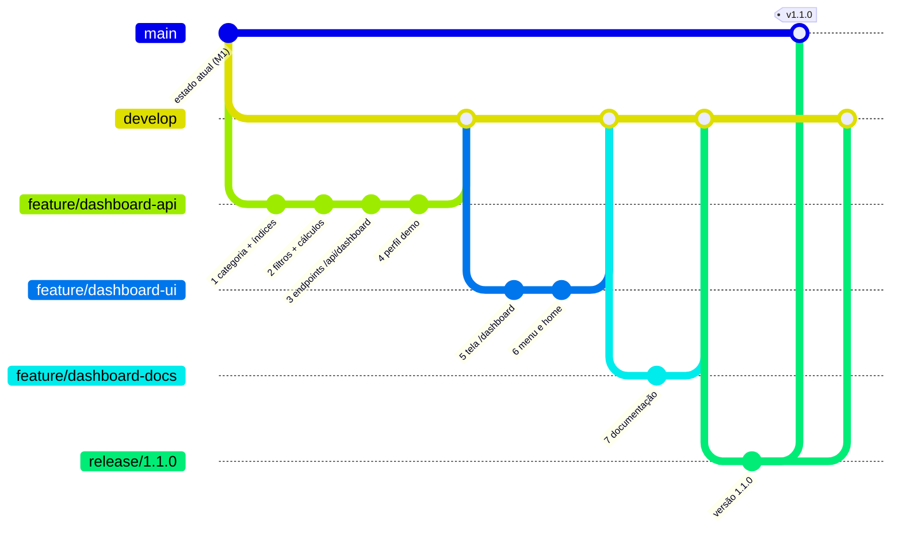

# 5. Guia de implementação com gitflow

[← Evidências de testes](04-evidencias-de-testes.md) · [Índice](README.md)

Este guia aplica as mudanças em etapas, cada uma com seu commit, seguindo o **gitflow**. A sequência foi validada: **em cada etapa o projeto compila e todos os testes passam**, e o resultado final é idêntico ao projeto entregue.

## 5.1 Estrutura de branches



| Branch | Função |
|---|---|
| `main` | Versões entregues (produção) |
| `develop` | Integração das funcionalidades |
| `feature/dashboard-api` | **Implementação da API com os endpoints integrados ao MongoDB** (pedida na atividade) |
| `feature/dashboard-ui` | Tela do dashboard |
| `feature/dashboard-docs` | Documentação |
| `release/1.1.0` | Preparação da versão. Vai para `main` com a tag `v1.1.0` e volta para `develop` |

> Não apague as branches `feature/*` depois do merge: elas são a evidência do gitflow na entrega. Use `--no-ff` nos merges para o histórico mostrar cada feature.

## 5.2 Preparação

```bash
git checkout main
git pull
# crie a develop se ainda não existir
git checkout -b develop
git push -u origin develop
```

> Se `develop` já existe: `git checkout develop && git pull`.

## 5.3 Branch `feature/dashboard-api`

```bash
git checkout -b feature/dashboard-api develop
```

Copie os arquivos de cada etapa a partir do projeto entregue (mesmo caminho), confira com os testes e faça o commit.

### Etapa 1: categoria no item e índices

| Arquivo | Mudança |
|---|---|
| `src/main/java/com/umc/pediupatrao/entity/ItemPedido.java` | Novo campo `categoria` com getter e setter |
| `src/main/java/com/umc/pediupatrao/entity/Pedido.java` | `@Indexed` em `status` e `dataHoraEntrada` |
| `src/main/java/com/umc/pediupatrao/service/PedidoService.java` | `criarItem` copia `produto.getTipo()` para o item |
| `src/test/java/com/umc/pediupatrao/service/PedidoServiceTest.java` | Novo teste `guardaACategoriaDoProdutoNoItemParaODashboard` |

```bash
./mvnw test          # esperado: 69 testes, 0 falhas
git add -A
git commit -m "feat(pedido): grava a categoria do produto no item e cria índices de consulta"
```

### Etapa 2: filtros e cálculo dos indicadores

| Arquivo | Mudança |
|---|---|
| `src/main/java/com/umc/pediupatrao/dto/dashboard/` (pasta inteira, 20 arquivos) | Novo: filtro, enums de opções e records de resposta |
| `src/main/java/com/umc/pediupatrao/exception/ParametroInvalidoException.java` | Novo (400) |
| `src/main/java/com/umc/pediupatrao/service/dashboard/` (`CalculadoraDashboard`, `CriteriosDashboard`, `LeitorParametros`) | Novo: regras de cálculo e validação |
| `src/test/java/com/umc/pediupatrao/service/dashboard/` (`PedidosDeTeste`, `CalculadoraDashboardTest`, `CriteriosDashboardTest`) | Novos testes |

```bash
./mvnw test          # esperado: 106 testes, 0 falhas
git add -A
git commit -m "feat(dashboard): validação dos filtros e cálculo dos indicadores de vendas"
```

### Etapa 3: endpoints `/api/dashboard` integrados ao MongoDB

| Arquivo | Mudança |
|---|---|
| `src/main/java/com/umc/pediupatrao/repository/PedidoDashboardRepository.java` | Novo: consultas com `MongoTemplate` |
| `src/main/java/com/umc/pediupatrao/service/DashboardService.java` | Novo: serviço com `@PreAuthorize` |
| `src/main/java/com/umc/pediupatrao/controller/DashboardController.java` | Novo: 8 endpoints GET |
| `src/main/java/com/umc/pediupatrao/controller/DashboardWebController.java` | Novo: rota da página `/dashboard` (o template entra na etapa 5) |
| `src/main/java/com/umc/pediupatrao/exception/ApiExceptionHandler.java` | Handlers de `ParametroInvalidoException` (400) e de parâmetro com tipo errado (400 com o nome do parâmetro) |
| `src/main/java/com/umc/pediupatrao/config/SecurityConfig.java` | 4 linhas: GET `/dashboard` e `/api/dashboard/**` para ADMIN e GERENTE; demais métodos negados |
| `src/test/java/com/umc/pediupatrao/repository/PedidoDashboardRepositoryTest.java` | Novo |
| `src/test/java/com/umc/pediupatrao/service/DashboardServiceTest.java` | Novo |
| `src/test/java/com/umc/pediupatrao/config/DashboardApiTest.java` | Novo |
| `src/test/java/com/umc/pediupatrao/config/DashboardAutorizacaoTest.java` | Novo |

```bash
./mvnw test          # esperado: 134 testes, 0 falhas
git add -A
git commit -m "feat(dashboard): endpoints /api/dashboard integrados ao MongoDB com acesso para ADMIN e GERENTE"
```

### Etapa 4: perfil de demonstração

| Arquivo | Mudança |
|---|---|
| `src/main/java/com/umc/pediupatrao/config/GeradorPedidosDemonstracao.java` | Novo: gerador de histórico |
| `src/main/java/com/umc/pediupatrao/config/DemonstracaoDashboardConfig.java` | Novo: executa o gerador no perfil `demo` |
| `src/main/resources/application-demo.properties` | Novo: banco `pediupatrao_demo` |
| `src/test/java/com/umc/pediupatrao/config/GeradorPedidosDemonstracaoTest.java` | Novo |

```bash
./mvnw test          # esperado: 139 testes, 0 falhas
git add -A
git commit -m "feat(demo): perfil demo com histórico de pedidos de exemplo para o dashboard"
git push -u origin feature/dashboard-api
```

**Integrar na develop.** Abra um Pull Request `feature/dashboard-api → develop` no GitHub, ou faça o merge pelo terminal:

```bash
git checkout develop
git merge --no-ff feature/dashboard-api -m "Merge branch 'feature/dashboard-api' into develop"
git push
```

Para conferir a API nessa etapa, rode a aplicação com o perfil `demo` e use a coleção Postman ou o script `testes-api.sh` da pasta `docs/dashboard` do projeto entregue (eles entram no repositório na etapa 7):

```bash
./mvnw spring-boot:run -Dspring-boot.run.profiles=demo
# em outro terminal (Git Bash), apontando para o script do projeto entregue:
bash /caminho/do/projeto-entregue/docs/dashboard/testes-api.sh
```

## 5.4 Branch `feature/dashboard-ui`

```bash
git checkout -b feature/dashboard-ui develop
```

### Etapa 5: tela do dashboard

| Arquivo | Mudança |
|---|---|
| `src/main/resources/templates/dashboard.html` | Novo: estrutura da tela |
| `src/main/resources/static/js/dashboard.js` | Novo: consumo da API, gráficos, filtros, atualização e erros |
| `src/main/resources/static/css/dashboard.css` | Novo: estilos do painel |
| `src/main/java/com/umc/pediupatrao/controller/DadosDoUsuarioNasTelas.java` | Inclui `DashboardWebController.class` em `assignableTypes` (usuário e perfil no menu) |

```bash
./mvnw test          # 139 testes
git add -A
git commit -m "feat(dashboard): tela /dashboard com indicadores, gráficos, filtros e atualização automática"
```

### Etapa 6: acesso pelo menu e pela home

| Arquivo | Mudança |
|---|---|
| `src/main/resources/templates/fragments/sidebar.html` | Item "Dashboard" (ADMIN e GERENTE) |
| `src/main/resources/templates/home.html` | Botão "Dashboard" (ADMIN e GERENTE) |
| `src/main/resources/static/css/style.css` | Menu lateral acompanha a rolagem em telas grandes |

```bash
git add -A
git commit -m "feat(layout): acesso ao dashboard pelo menu e pela home"
git push -u origin feature/dashboard-ui
git checkout develop
git merge --no-ff feature/dashboard-ui -m "Merge branch 'feature/dashboard-ui' into develop"
git push
```

## 5.5 Branch `feature/dashboard-docs`

### Etapa 7: documentação

| Arquivo | Mudança |
|---|---|
| `docs/dashboard/` (pasta inteira) | Requisitos, projeto, API, evidências, guia, Postman, script de testes e capturas |
| `README.md` | Seção do dashboard e endpoints novos na tabela de API |

> Antes deste commit, substitua as capturas de `docs/dashboard/evidencias/telas/` pelas do seu ambiente (roteiro na [seção 4.4](04-evidencias-de-testes.md#44-roteiro-para-capturar-as-evidências-no-seu-ambiente)), mantendo os mesmos nomes de arquivo.

```bash
git checkout -b feature/dashboard-docs develop
git add -A
git commit -m "docs(dashboard): requisitos, projeto, documentação da API e evidências de testes"
git push -u origin feature/dashboard-docs
git checkout develop
git merge --no-ff feature/dashboard-docs -m "Merge branch 'feature/dashboard-docs' into develop"
git push
```

## 5.6 Release e entrega

```bash
git checkout -b release/1.1.0 develop
# opcional: no pom.xml, troque <version>1.0-SNAPSHOT</version> por <version>1.1.0</version>
./mvnw test
git commit -am "chore(release): versão 1.1.0 - dashboard administrativo"
git push -u origin release/1.1.0

git checkout main
git merge --no-ff release/1.1.0 -m "Release 1.1.0 - Dashboard administrativo"
git tag -a v1.1.0 -m "Dashboard administrativo (M2)"
git push origin main --tags

git checkout develop
git merge --no-ff release/1.1.0 -m "Merge branch 'release/1.1.0' into develop"
git push
```

## 5.7 Conferência final

- [ ] `./mvnw test` → `Tests run: 139, Failures: 0, Errors: 0`
- [ ] No GitHub, aparecem as branches `develop`, `feature/dashboard-api`, `feature/dashboard-ui`, `feature/dashboard-docs`, `release/1.1.0` e a tag `v1.1.0`
- [ ] Com o perfil `demo`, o GERENTE vê o dashboard completo, o ADMIN vê nomes mascarados e o ATENDENTE recebe 403 (e a tentativa aparece na Auditoria)
- [ ] A coleção Postman roda sem falhas
- [ ] As capturas da pasta `evidencias/telas` são do seu ambiente
- [ ] A apresentação está pronta (roteiro no [README](README.md#roteiro-da-apresentação))
