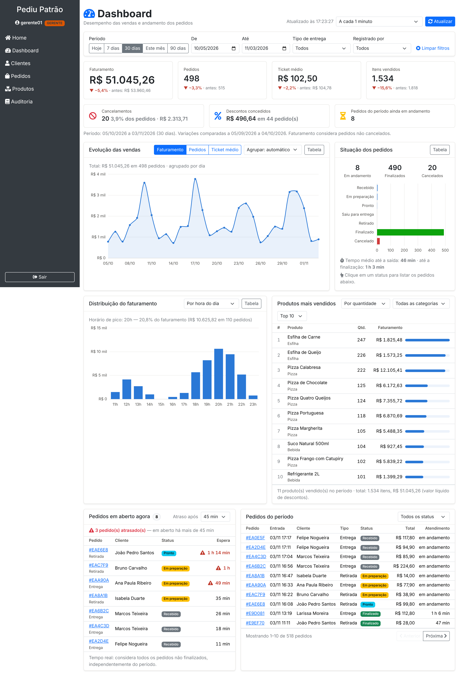

# Dashboard Administrativo — Pediu Patrão (Atividade Prática M2)

Painel gerencial integrado ao sistema de pedidos. O responsável pelo estabelecimento acompanha vendas, pedidos e tendências da operação. Os dados vêm de uma API REST própria (`/api/dashboard/**`), integrada ao MongoDB.



## Documentação

| # | Documento | Conteúdo |
|---|---|---|
| 1 | [Requisitos](01-requisitos.md) | Contexto, atores, requisitos funcionais RF01–RF07, requisitos não funcionais e regras de negócio |
| 2 | [Análise e projeto](02-analise-e-projeto.md) | Arquitetura, fluxo de uma consulta, modelagem de dados, projeto da API e decisões de projeto com justificativas |
| 3 | [Documentação dos endpoints](03-api-endpoints.md) | Os 8 endpoints com parâmetros, exemplos reais de requisição e resposta e possíveis erros |
| 4 | [Evidências de testes](04-evidencias-de-testes.md) | 139 testes automatizados, 28 cenários HTTP, coleção Postman (56 verificações) e capturas da interface |
| 5 | [Implementação e gitflow](05-implementacao-e-gitflow.md) | Passo a passo das branches e commits, com os arquivos de cada etapa |

Arquivos de apoio:
- [`PediuPatrao-Dashboard.postman_collection.json`](PediuPatrao-Dashboard.postman_collection.json): coleção Postman com testes automáticos.
- [`testes-api.sh`](testes-api.sh): roteiro de testes da API com `curl`.
- [`evidencias/`](evidencias/): capturas de tela, saída dos testes HTTP e relatórios do Surefire.

## Como executar

Pré-requisitos: JDK 21 e acesso à internet (MongoDB Atlas, dependências Maven e Bootstrap via CDN).

```bash
# Com o banco do projeto (seus dados reais)
./mvnw spring-boot:run

# Demonstração: banco separado "pediupatrao_demo" com 120 dias de pedidos de exemplo
./mvnw spring-boot:run -Dspring-boot.run.profiles=demo
# Windows (PowerShell): .\mvnw.cmd spring-boot:run "-Dspring-boot.run.profiles=demo"
```

Acesse `http://localhost:8080`, entre como **gerente01 / gerente123** (ou **admin / teste123**) e clique em **Dashboard** no menu.

| Usuário | Perfil | Dashboard |
|---|---|---|
| `gerente01` / `gerente123` | GERENTE | ✅ completo |
| `admin` / `teste123` | ADMIN | ✅ com nomes de clientes mascarados |
| `atendente01` / `atendente123` | ATENDENTE | ❌ 403 (tentativa registrada na auditoria) |

O perfil `demo` só gera pedidos se a coleção `pedidos` do banco `pediupatrao_demo` estiver vazia. Para gerar de novo, apague essa coleção no Atlas. O banco principal (`pediupatrao_gustavo`) nunca é alterado por esse perfil.

## O que o dashboard oferece

| Requisito | Na tela | Endpoint |
|---|---|---|
| RF01 Indicadores gerais | Faturamento, pedidos, ticket médio e itens, com variação em relação ao período anterior; cancelamentos, descontos e pedidos em andamento | `GET /api/dashboard/resumo` |
| RF02 Análise de vendas | Evolução diária, semanal ou mensal; distribuição por hora, dia da semana, categoria e tipo de entrega | `GET /api/dashboard/vendas/serie`, `/vendas/distribuicao` |
| RF03 Situação dos pedidos | Pedidos por status, tempos médios, fila em tempo real com atrasados, lista paginada | `GET /api/dashboard/pedidos/situacao`, `/pedidos/em-aberto`, `/pedidos` |
| RF04 Produtos mais vendidos | Ranking por quantidade ou faturamento, por categoria, Top 5/10/20 | `GET /api/dashboard/produtos/mais-vendidos` |
| RF05 Filtros | Período (com atalhos), tipo de entrega, atendente, status, categoria; filtros gravados na URL | `GET /api/dashboard/filtros` + parâmetros |
| RF06 Integração com a API | A tela só exibe o que a API devolve | todos |
| RF07 Atualização e tratamento | Atualização manual e automática, "Atualizado às…", cancelamento de requisições antigas, validação 400/422, mensagens de erro, dados legados | todos |

## Roteiro da apresentação

Sugestão de 10 a 12 minutos:

1. **Problema (1 min):** o sistema registrava pedidos, mas o responsável não tinha visão de desempenho. Objetivo e requisitos RF01–RF07.
2. **Análise (2 min):** quais perguntas o gestor precisa responder, e daí os endpoints. Regras de negócio principais: venda = pedido não cancelado, comparação com o período anterior, desconto rateado, atraso.
3. **Projeto (2 min):** diagrama de arquitetura, alterações no modelo (categoria no item e índices) e as decisões da tabela 2.5 (agregar em Java × pipeline, 400 × 422, duas camadas de segurança, perfil `demo`).
4. **Demonstração (4 min):** login como GERENTE, depois:
   - indicadores e variação;
   - gráfico com tooltip;
   - troca de agrupamento e de dimensão;
   - ranking por faturamento e por categoria;
   - clique em "Cancelado" no gráfico de status;
   - fila com atrasados;
   - filtro "7 dias" + "Retirada" e URL compartilhável;
   - erro de período;
   - ADMIN com nomes mascarados;
   - ATENDENTE com 403 e o registro na Auditoria.
5. **API e testes (2 min):** Postman Runner (56 verificações), `./mvnw test` (139 testes) e um erro 422 com a mensagem.
6. **Gitflow e próximos passos (1 min):** branches no GitHub. Evoluções possíveis: totais diários pré-calculados para grandes volumes, exportação CSV/PDF, metas de faturamento.
